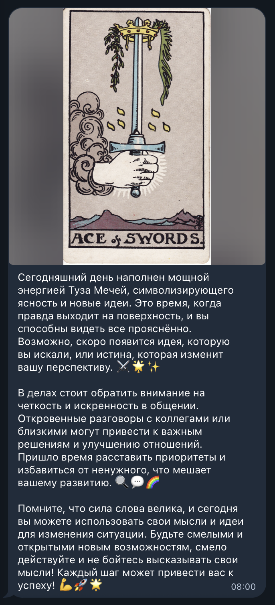
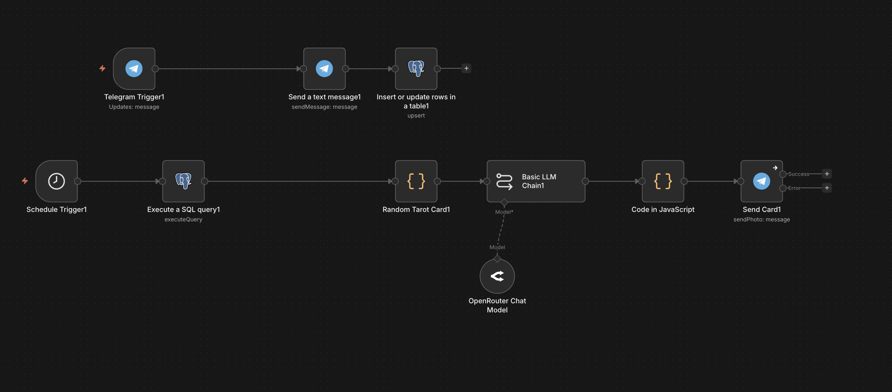
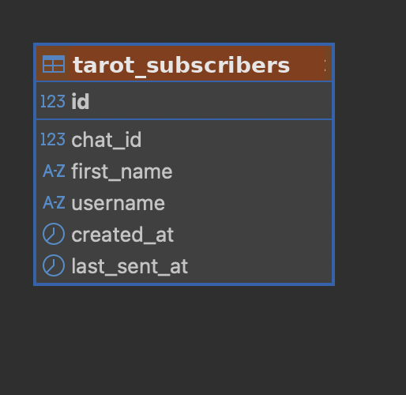

# 🔮 Daily Tarot Card Bot

Telegram bot that sends a random daily tarot card every morning with an image, meaning, and short reflection.

> This project is for entertainment and self-reflection purposes only. It does not provide professional, medical, legal, financial, or psychological advice.

## 🇬🇧 Short Description

**Daily Tarot Card Bot** is a simple Telegram automation project.

Every morning, the bot selects a random tarot card, sends the card image, explains the meaning, and gives the user a short reflection for the day.

The project is designed as a portfolio-ready automation template built with **Telegram Bot API, n8n, PostgreSQL, and scheduled workflows**.

---

## 🇷🇺 Краткое описание

**Daily Tarot Card Bot** — это простой Telegram-бот с ежедневной картой Таро.

Каждое утро бот выбирает случайную карту, отправляет изображение, краткое значение карты и небольшой совет дня.

Проект подготовлен как портфолио-шаблон автоматизации на базе **Telegram Bot API, n8n, PostgreSQL и scheduled workflows**.

---

## 🖼️ Demo Screenshots

### Daily tarot card message



### n8n workflow overview



### PostgreSQL subscribers table



More details: [`docs/demo-screenshots.md`](docs/demo-screenshots.md)

---

## ✨ Features

- Daily scheduled tarot card delivery
- Random card selection
- Card image + caption
- Short meaning and reflection
- PostgreSQL user and delivery history
- Safe demo configuration
- No payments or subscriptions
- No personal predictions stored publicly

---

## 🧩 Architecture

```text
Schedule Trigger
        ↓
Select Active Users
        ↓
Pick Random Tarot Card
        ↓
Load Card Image + Meaning
        ↓
Send Telegram Photo + Caption
        ↓
Save Delivery History
```

More details: [`docs/architecture.md`](docs/architecture.md)

---

## 🛠️ Tech Stack

- Telegram Bot API
- n8n
- PostgreSQL
- Scheduled workflow
- JSON card dataset
- Image URLs / local assets

---

## 📁 Repository Structure

```text
daily-tarot-card-bot/
├── README.md
├── LICENSE
├── .gitignore
├── .env.example
├── docs/
│   ├── architecture.md
│   ├── setup-checklist.md
│   ├── security.md
│   ├── legal-disclaimer.md
│   ├── demo-screenshots.md
│   └── screenshots/
│       ├── 01-daily-card-message.png
│       ├── 02-n8n-workflow.png
│       └── 03-postgresql-subscribers.png
├── sql/
│   ├── 001_schema.sql
│   ├── 002_demo_data.sql
│   └── 003_queries.md
├── n8n/
│   ├── workflow-notes.md
│   └── workflow-placeholder.json
├── bot/
│   ├── telegram-message-examples.md
│   └── tarot-cards-demo.json
└── assets/
    └── README.md
```

---

## ⚙️ Setup Outline

1. Create a Telegram bot.
2. Create PostgreSQL database.
3. Run SQL schema.
4. Import the n8n workflow locally.
5. Configure Telegram credentials locally.
6. Configure the schedule trigger.
7. Add active users.
8. Test daily card delivery.

---

## 🔐 Security Notes

Never commit:

- Telegram bot token
- real `chat_id` values
- real `user_id` values
- `.env` files with real values
- n8n credentials
- production webhook URLs
- private user messages

Use `.env.example` with placeholders only.

See: [`docs/security.md`](docs/security.md)

---

## ⚖️ Disclaimer

This bot is for entertainment and self-reflection only.

It does not provide professional, medical, legal, financial, psychological, or spiritual guarantees.

See: [`docs/legal-disclaimer.md`](docs/legal-disclaimer.md)

---

## 📌 Project Tagline

**English:**  
Telegram bot that sends a random daily tarot card with an image, meaning and short reflection.

**Russian:**  
Telegram-бот, который каждое утро отправляет случайную карту Таро с картинкой, значением и коротким советом дня.

## Maintenance checklist

These items describe planned checks rather than completed verification. Record the synthetic draw or delivery fixture, observed outcome, and tested commit when checking an item; mark checks not performed as untested.

Maintenance note: verify every active demo card has both a readable caption and a usable image fallback.

Maintenance note: confirm disabled subscribers are excluded immediately before each scheduled send.

Maintenance note: confirm demo image URLs remain reachable before portfolio demonstrations.

Maintenance note: verify the documented delivery time uses an explicit timezone to avoid daylight-saving drift.

Maintenance note: verify a retried scheduled run does not send a second daily card to users already marked delivered.

Maintenance note: confirm delivery history records failures separately from successful sends for easier retry checks.

Maintenance note: verify retry logic targets only failed deliveries and never resends previously successful ones.

Maintenance note: test schedule changes with a demo subscriber before applying a new delivery timezone to production.

Maintenance note: keep a text-only fallback ready so a broken card image does not block the daily message.

Maintenance note: confirm each demo card ID is unique and maps to exactly one caption and image reference.

Maintenance note: keep documented card dataset paths synchronized with the current demo asset layout.

Maintenance note: confirm demo subscriber screenshots use synthetic IDs and names only before portfolio publication.

Maintenance note: verify every referenced demo card asset exists before recording screenshots or publishing examples.

Maintenance note: confirm overlapping schedule triggers cannot deliver two cards to the same demo subscriber for one local calendar day.

Maintenance note: verify a timezone change does not shift the same subscriber into two sends within one local date.

Maintenance note: validate the demo card dataset parses cleanly and contains no duplicate normalized card names before publishing a new portfolio build.

Maintenance note: confirm a freshly reset demo delivery history starts at zero successful sends before the next scheduled portfolio test.

Maintenance note: verify the delivery store enforces at most one successful card record per subscriber and local calendar date.

Maintenance note: after a scheduled demo run, verify the reported success/failure totals exactly match the persisted delivery-history rows.

Maintenance note: verify a synthetic dry-run with an unavailable image fallback records a safe failure without creating a success-history row.

Maintenance note: reconcile an ambiguous provider result against the original delivery identity before any retry is attempted.

Maintenance note: persist the delivery identity before sending so a restart can reuse the same idempotency key instead of issuing a blind second delivery.

Maintenance note: match provider acknowledgement to the stored delivery identity and idempotency key; reconcile timeouts before retrying the same subscriber and local date.

Maintenance note: verify recovery and retries after ambiguous delivery results keep one success record and one user-visible card for each subscriber and local date; reconcile unresolved outcomes before retrying.

Maintenance note: verify recovery reuses the original provider delivery identity before retrying an ambiguous result.

Maintenance note: verify one provider acknowledgement produces one success record per subscriber and local date after recovery.

Maintenance note: verify an ambiguous provider acknowledgement is reconciled against subscriber and local-date identity before retry.

Maintenance note: verify a provider timeout is reconciled before retry so one subscriber/date receives only one visible card.

Maintenance note: verify a subscriber crossing a timezone date boundary receives exactly one card for each resolved local date.

Maintenance note: verify a permanent blocked-user response disables further delivery attempts without creating a retry loop.

Maintenance note: verify concurrent scheduler workers cannot create duplicate delivery intents for the same subscriber and local date.

Maintenance note: verify invalid or missing subscriber timezone data falls back deterministically without creating duplicate daily deliveries.

Maintenance note: document the local-time boundary used to decide whether today's card has already been delivered after a restart.

Maintenance note: document when delivery is recorded relative to Telegram acknowledgement so retries cannot duplicate a daily card.

Maintenance note: document how blocked users are removed from active delivery attempts while preserving non-sensitive delivery history.

Maintenance note: document the scheduler-lock strategy that prevents duplicate daily deliveries when multiple workers start.

Maintenance note: document delivery behavior across daylight-saving transitions and other local timezone offset changes.

Maintenance note: document aggregate reporting for partial delivery failures without exposing subscriber identifiers.

Maintenance note: verify a content-generation timeout never marks the daily card as delivered before a message is accepted.

Maintenance note: document content length and formatting validation performed before a generated daily card is sent.

- Document the deterministic fallback used when generated card content fails validation; use synthetic empty, oversized, and malformed responses to select a versioned local fallback for the original card and language, record the validation category, and avoid a second draw or unbounded provider retry.

- Document how scheduled delivery behaves when a user's timezone setting is missing or invalid.

- Document how retries preserve one-card-per-day semantics after an interrupted delivery attempt.

- Document how blocked-user responses are recorded without repeatedly retrying permanent delivery failures.

- Document the default delivery window and how missed sends are handled after scheduler downtime; use synthetic restarts inside and beyond the local window to define deliver, defer, or skip decisions, preserving the stable daily-draw key and at most one acknowledged delivery per subscriber date.

- Document how content-generation retries avoid sending different card interpretations for the same daily draw; use a synthetic provider timeout before and after a validated response to specify storage under the stable draw key, reuse of the first accepted interpretation, and suppression of alternate text after delivery is acknowledged.

- Document the procedure for resuming scheduled sends after maintenance without duplicating already delivered cards.

- Document how a user's delivery preference change is applied when a daily message is already queued; use synthetic time, language, and format changes before and after queueing to define which settings are revalidated at send time while preserving the original daily-draw identifier and one-delivery limit.

- Document delivery-metric scope using synthetic production-labelled, test, and manual-preview events; specify which enter success, failure, and attempt totals, and apply the same exclusions to rate denominators so previews cannot inflate reported delivery performance.

- Document how queued daily messages are cancelled when a user opts out before delivery.

- Document scheduler health for zero eligible recipients using a synthetic empty selection and a mocked selection failure; distinguish a completed no-op run from a failed lookup, recording no delivery successes in either case and never treating an unavailable recipient query as an empty audience.

- Document the stable daily-draw identifier used to preserve one interpretation across generation and delivery retries; define its synthetic subscriber alias, local draw date, and deck version components, creation point, immutability rules, and reuse across provider retries without exposing production identifiers.

- Document how scheduler clock corrections are handled without skipping or duplicating a user's daily delivery; simulate forward and backward jumps around a synthetic local delivery window, preserve the stable daily-draw key, and record the expected deliver, defer, or skip decision with at most one acknowledged send.

- Document retention and cleanup rules for daily-draw identifiers after their retry window has expired; use synthetic active, expired, and unresolved deliveries to define cleanup eligibility, preserving deduplication evidence until no permitted retry or reconciliation can resend the same draw.

- Document delayed-card handling across local midnight with synthetic queued and already-delivered draws; define expiry or deferred delivery explicitly, preserve the original draw-date key, and specify interaction with the new day's schedule without relabelling yesterday's card as today's draw.

- Document how delivery metrics use stable attempt identifiers so retries do not inflate failure counts; replay synthetic timeout, retry, late acknowledgement, and permanent failure events under one delivery identity to define attempt, delivery, success, and terminal-failure counters plus their denominator rules.

- Document the content-template version recorded with each daily draw for consistent retry behavior; use a synthetic queued draw followed by a template update to specify whether retries reuse saved rendered content or its pinned template version, and define an explicit unresolved outcome when neither is available instead of silently regenerating the message.

- Document how a language preference change is applied when today's card is generated but not yet delivered; use a synthetic pending draw to define translation selection or fallback, preserve its card identifier and local-date key, and verify a language edit does not create a second draw.

- Document the generation-provider version recorded with a daily card so later retries remain auditable; use a synthetic draw to define provider and model-version fields, record unavailable versions explicitly, and reuse saved content on delivery retry without storing credentials or claiming exact regeneration.

- Document how missed-delivery recovery respects a timezone change made after the original delivery window; use a synthetic missed job and an already-delivered local-date record to define skip or reschedule behavior in the new timezone without replaying a card already acknowledged.

- Document how scheduler-run identifiers correlate duplicate wake-ups in metrics without exposing subscriber information; use two synthetic wake-ups for one scheduled job to distinguish run identifiers from the stable delivery key, recording aggregate duplicate counts without subscriber identifiers as metric labels.

- Document the safe content fallback used when a card record is missing optional metadata at delivery time; use synthetic absent attribution or subtitle fields to define omission without fabricated values, while treating a missing card title or meaning as invalid required content rather than optional metadata.

- Document scheduled-date validation around daylight-saving transitions so each subscriber receives at most one daily card; use synthetic skipped and repeated local times in a named timezone to define gap handling, repeated-hour selection, and a stable local-date delivery key.

- Document accessible text-only delivery when a card image asset is missing or fails validation; use synthetic missing and invalid assets to specify a complete card title and meaning in the text fallback, preserve the selected card, and verify only one delivery is acknowledged.

- Document how an opt-out received during queued delivery cancels unsent daily-card messages; use a synthetic queued job paused before send to specify a final subscription check, cancellation status, and restart persistence without attempting to recall already delivered messages.

- Document deck-version migration so a content refresh does not repeat a subscriber's card for the same local date; use synthetic delivered and pending records across a deck upgrade to define version assignment, preserve delivery-day deduplication, and handle removed card identifiers explicitly.

- Document locale fallback behavior when a card translation is incomplete or unavailable at send time; use synthetic missing-title and missing-body cases to define a complete fallback language, preserve the selected card and delivery-day key, and avoid sending mixed-language fragments.

- Document quiet-hour handling when a subscriber's delivery window crosses local midnight; use a synthetic overnight interval to define inclusive and exclusive boundaries, next eligible local time, and whether a deferred card is skipped or delivered once after quiet hours end.

- Document bounded retry behavior after a subscriber blocks the bot so failed daily deliveries do not loop indefinitely; mock an explicit blocked-bot rejection separately from a transient timeout to specify terminal delivery status, retry limits, and reactivation only after a new subscriber interaction.

- Document how a pending scheduled delivery is re-evaluated when the subscriber changes timezone before it is sent; use a synthetic move across midnight to define the delivery-day key, next eligible time, and treatment of an already delivered card without sending twice.

- Document deduplication of Telegram update identifiers after a restart so commands are not processed twice; replay one synthetic update identifier before and after restart to specify persistence and retention behavior and verify the command handler records only one execution.

- Document validation of card image references during content updates so scheduled messages never contain broken media; check synthetic valid, missing, and wrong-type references before release, and specify that validation failure preserves the previously active card content.

- Document rollback steps for a card-content release when validation fails after scheduled delivery begins; use a synthetic active release with one invalid card to specify how remaining deliveries stop, the prior content version is restored, and already delivered cards are not resent.

- Document localization checks for escaped Markdown and message-length limits before new card text is released; use synthetic non-Latin text, emoji, and formatting punctuation just below, at, and above the configured limit to specify validation outcomes without silently truncating card meaning.

- Document fallback behavior when a cached Telegram media identifier is no longer valid at delivery time; mock an explicit invalid-media rejection and specify fallback selection separately from an ambiguous timeout so retries do not blindly duplicate a daily card.

- Document subscriber deduplication when importing or migrating scheduling data between environments; use synthetic duplicate subscriber keys with conflicting timezone or opt-out values to define conflict resolution, preserve opt-out, and verify only one active schedule remains.

- Document scheduler lease ownership so parallel workers cannot send the same subscriber's daily card twice; simulate two workers contending for one synthetic delivery and specify that only the lease owner may send while a former owner cannot act after lease expiry.

- Document subscription-consent timestamps without retaining unnecessary message content or profile details; use a synthetic opt-in event to specify timestamp format, consent source, and fields intentionally omitted from public diagnostics.

- Document validation of subscriber timezones against canonical IANA identifiers before scheduling deliveries; include valid, unknown, and missing timezone values in synthetic subscriber fixtures and state the expected validation or fallback outcome for each.

- Document deterministic card-selection seeds for test environments without exposing or reusing production subscriber identifiers; record the test seed and deck version, then verify repeated runs select the same card from the unchanged demo deck.

- Document delivery fallback when Telegram rejects scheduled media because the uploaded file exceeds current size limits; simulate the rejection with synthetic subscriber data and verify the text-only fallback preserves the original daily draw and records success only after acknowledgement.

- Document how an on-demand daily-card request is reconciled with a scheduled delivery for the same subscriber and local date; race two synthetic requests to verify both resolve to the same selected card, create one delivery-day record, and never send a second card after either path succeeds.

- Document how a queued daily-card delivery reacts when the subscriber changes language before send time; use synthetic pending and already-delivered cases to define final preference revalidation, preserve the selected card and local-date key, and prevent mixed-language content or duplicate delivery.

- Document immutable card-revision identifiers for delivery audits when text or artwork changes without a deck-version bump; use synthetic pre- and post-edit content to specify revision hashing, preserve the delivered revision record, and avoid storing subscriber data in the identifier.

- Document scheduler behavior when the host wall clock moves forward or backward during a delivery window; use synthetic clock jumps to preserve one stable subscriber-local date key, bound overdue processing, and prevent duplicate or prematurely skipped cards.

- Document which Telegram chat types may create subscriptions and request daily cards; use synthetic private, group, supergroup, and channel updates to define supported behavior, prevent accidental group subscriptions, and avoid exposing subscriber preferences in shared chats.

- Document handling of stale or replayed inline-button callbacks from earlier bot messages; use synthetic callback identifiers, message revisions, and subscriber states to specify safe acknowledgement, no duplicate draw or subscription change, and a current-action prompt where needed.

- Document operator-triggered resend behavior for a failed daily delivery; use synthetic current, expired, already-successful, and unsubscribed delivery records to require the original idempotency key, recheck consent, and prevent a manual action from creating a second draw.

- Document delivery-state handling when a subscriber blocks the bot before a scheduled card and later unblocks it; use synthetic forbidden, restored, and still-unavailable sends to define subscription status, bounded retry, and whether the missed card expires without generating a second draw.

- Document behavior when deck filters leave no eligible card for a subscriber-local day; use synthetic empty, one-card, and restored-deck cases to return a neutral unavailable status, preserve the daily idempotency key, and avoid selecting an excluded card or rerolling repeatedly.

- Document card-image validation before delivery; use synthetic valid, corrupt, oversized, wrong-content-type, and dimension-mismatched assets to select the documented text fallback, preserve the original daily draw, and avoid repeatedly fetching an invalid image.

- Document escaping and parse-mode validation for card titles, meanings, and attribution before Telegram delivery; use synthetic Markdown and HTML metacharacters, malformed entities, and plain text to prevent formatting failures, preserve the original draw, and fall back to readable unformatted content.

- Document Telegram message-length validation after escaping and localization; use synthetic boundary, over-limit, multi-byte, and entity-heavy card text to split or select the documented concise fallback without cutting an entity, changing the draw, or sending duplicate fragments.

- Document delivery reconciliation when Telegram accepts a card but the client loses the response before persisting success; use synthetic confirmed, rejected, timeout, and unknown outcomes to retain one delivery key, avoid immediate blind resend, and expose an operator-reviewable uncertain status without drawing again.

- Document handling of an invalid, removed, or unresolvable subscriber timezone; use synthetic valid, aliased, unknown, and temporarily unavailable zone data to pause scheduling with a neutral correction prompt, preserve prior delivery history, and avoid silently falling back to server time.

- Document validation and fallback when a localized deck entry is missing required title, meaning, or attribution fields; use synthetic complete, partial, empty, and malformed translations to select the documented readable fallback, preserve the original card and delivery-day key, and avoid mixing languages or rerolling the draw.

- Document recovery when a queued delivery references a deck or card revision that is no longer available; use synthetic present, archived, missing, and hash-mismatched revisions to preserve the original draw and delivery-day key, fail visibly without rerolling, and allow resend only from a verified immutable revision.

- Document revalidation when a subscriber changes deck or card-filter preferences after a daily draw is queued but before delivery; use synthetic unchanged, narrowed, emptied, and restored preferences to preserve one delivery-day key, suppress an ineligible queued card without rerolling silently, and define the next eligible draw explicitly.

- Document Telegram bot-token rotation while scheduled deliveries are queued; use synthetic current, overlap, retired, invalid, and unknown-outcome credentials to pause new sends during cutover, preserve delivery idempotency keys, resume only after a non-sensitive capability check, and never record token values in logs or fixtures.

- Document delivery-history reconciliation after a database restore; use synthetic current, stale, future-dated, duplicated, and partially restored records to preserve acknowledged delivery-day keys, quarantine ambiguous rows, avoid replaying cards, and resume scheduling only after the restored snapshot is validated.

- Document subscriber data-erasure handling across preferences, queued deliveries, and delivery history; use synthetic pending, delivered, failed, and repeated requests to stop future sends, remove or anonymize fields according to the retention policy, preserve only non-identifying operational evidence, and never regenerate a deleted draw.

- Document atomic activation of a new deck or content version across parallel scheduler workers; use synthetic old, staged, activated, rolled-back, and mixed-cache states to pin each daily draw to one verified version, prevent mixed title/artwork delivery, and keep already acknowledged cards unchanged.

- Document immutable media references for card artwork served through a cache or CDN; use synthetic current, stale-cached, missing, hash-mismatched, and rolled-back assets to bind each queued draw to one verified artwork revision, fail visibly without rerolling, and keep acknowledged deliveries unchanged.

- Document recovery when a stored Telegram media `file_id` is rejected or no longer reusable; use synthetic valid, expired, wrong-bot, missing, and transient-error cases to retry only from the same verified artwork revision, preserve the delivery-day key, avoid rerolling the card, and keep media bytes out of logs.

- Document scheduler leadership leases with fencing across parallel workers; use synthetic current-leader, expired-lease, delayed-worker, split-brain, and handoff cases to ensure only the newest fenced worker can queue a daily card, preserve delivery-day idempotency, and prevent duplicate draws or sends.

- Document subscription recovery after a user unblocks the Telegram bot; use synthetic still-blocked, unblocked-without-command, explicit-resubscribe, duplicate-resubscribe, and stale-queue cases to require fresh consent, avoid backfilling missed cards, preserve future delivery idempotency, and keep prior content private.

- Document scheduler behavior when worker clocks differ from the authoritative database or queue clock; use synthetic aligned, fast, slow, corrected, and unavailable-time cases to derive one delivery-day boundary, fence premature or late claims, preserve idempotency keys, and avoid duplicate or skipped cards.

- Document delivery formatting when card text exceeds Telegram photo-caption or message-length limits; use synthetic short, boundary, oversized, multilingual, and markup-heavy content to split deterministically, preserve one delivery-day key and artwork revision, avoid duplicate sends, and never truncate attribution silently.

- Document idempotent handling of repeated subscribe and unsubscribe commands; use synthetic first, duplicate, delayed, reordered, and concurrent commands to converge on one explicit subscription state, cancel or retain queued deliveries according to the final confirmed choice, and avoid exposing prior card history in responses.

- Document queue backpressure when a provider outage creates a large delivery backlog; use synthetic short, prolonged, recovered, expired-day, and partial-drain cases to bound concurrency, prioritize still-valid daily cards deterministically, suppress stale catch-up sends, and preserve one delivery-day idempotency key per subscriber.

- Document delivery-time changes while a daily-card job is already queued; use synthetic earlier, later, timezone-shifted, concurrent-change, stale-worker, and send-in-progress cases to version the schedule, cancel or supersede only the prior pending job, preserve one delivery-day idempotency key, and avoid duplicate or catch-up sends.

- Document Telegram flood-control handling for daily-card delivery; use synthetic per-chat, global, missing-`retry_after`, repeated-429, recovered, and expired-day cases to respect authoritative backoff, bound retries with jitter, preserve one delivery-day idempotency key, and suppress stale catch-up sends.
